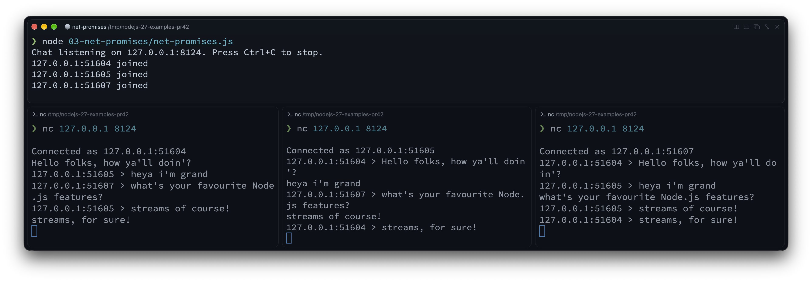

On October 29, 2026, the Node.js team published [`v27.0.0-alpha.0.0.0`](https://nodejs.org/en/blog/release/v27.0.0-alpha.0.0.0). If you have been using Node.js for a few years, that version string alone probably made you do a double take. Where is the usual October `v27.0.0` Current release?

Node.js 27 is the first release to follow the new annual schedule. Under the old schedule, October brought a major release that reached end of life six months later without entering Long Term Support (LTS). October now starts a six-month Alpha phase, ahead of the `27.0.0` Current release in April 2027 and LTS promotion in October 2027.

:::note[Wait, an odd-numbered Node.js release becoming LTS?]
Yes, the odd/even split is gone. Version numbers now match the calendar year (27 in 2027), with one major release per year, and every release becomes LTS. We covered the timeline and the reasons for the change in [Node.js is changing its release schedule and version numbers](/blog/nodejs-release-schedule-changes/). Because Node.js 27 is currently in its Alpha window, we will keep updating this article as new builds land on the way to April 2027.
:::

In this first Alpha, V8 moves from 14.6 to 15.6, adding `Iterator.zip()`, `Iterator.zipKeyed()`, `Iterator.prototype.join()`, `Iterator.prototype.includes()`, and `Math.sumPrecise()`. There is a promises API for `node:net`, along with async-iterable TCP servers. The Virtual File System (`node:vfs`) is now unflagged, the Permission Model gains `--allow-env`, and HTTP and memory defaults change too.

We'll start with the JavaScript and Node.js APIs you can use in everyday code, comparing them with the older approaches. Then we'll cover runtime changes and what to check before upgrading.

:::note[Code samples]
Every code block with a file path in its title matches a runnable file in the companion repo [`lmammino/nodejs-27-examples`](https://github.com/lmammino/nodejs-27-examples) on GitHub.
:::

## Quick Answer: what's new in Node.js 27

The main additions in Node.js 27 so far:

1. New `Iterator` helpers (`zip`, `zipKeyed`, `join`, `includes`) pair sequences, join their values into strings, and search them without collecting intermediate arrays.
2. `Math.sumPrecise()` sums an iterable of numbers without rounding each intermediate addition.
3. `node:net/promises` and async-iterable `net.Server` let you use `async`/`await` to set up TCP servers and sockets.
4. Virtual File System (`node:vfs`) is unflagged, making in-memory file systems and `--vfs-load` available without `--experimental-vfs`.
5. Core upgrades across `fs`, permissions, test runner, and `http`, including atomic temp files with `fs.mkstemp()`, `--allow-env`, Jest-style mock helpers, and a 65-second HTTP `keepAliveTimeout`.
6. V8 15.6 and OpenSSL 4.1 update sorting and cryptography, and the default heap limit rises to 4 GB on an 8 GB machine.

For example, we can format a list of products and total their prices:

```js title="00-quick-answer/teaser.js"
const items = ['Keyboard', 'Mouse', 'Monitor']
const prices = [129.99, 49.99, 349.95]

const lines = Iterator.zipKeyed({ item: items, price: prices })
  .map(({ item, price }) => `${item} ($${price.toFixed(2)})`)
  .join(', ')

console.log(`${lines} -> Total: $${Math.sumPrecise(prices)}`)
// Keyboard ($129.99), Mouse ($49.99), Monitor ($349.95) -> Total: $529.93
```

If you want to experiment locally, [check your current Node.js version](/blog/checking-node-js-version/) before running the snippets below.

## New Iterator superpower: `zip`, `zipKeyed`, `join`, and `includes`

This is the part of the release I'm most excited about. I love seeing how far we can push streams, iterators, and generators. Our article on [JavaScript async iterators](/blog/javascript-async-iterators/) should give you an idea of what I mean.

In [What's new in Node.js 26](/blog/whats-new-in-nodejs-26/), we used `Iterator.concat()` to consume multiple iterables one after another. Node.js 27, through V8 15.6, lets us consume them side by side, pairing values at the same position.

### Pairing sequences lazily with `Iterator.zip()`

Suppose you are checking a weather forecast against the temperatures recorded over the same four days. The predictions come from your model, while the actual values come from observations. To calculate each day's error, you need to pair the values at the same position. Both sequences must cover the same days in the same order.

In Node.js 26 and earlier, if both sequences were arrays, you would typically use `.map()` with an index lookup:

```js title="01-iterators/iterator-zip-old.js"
// Node.js 26 and earlier
const predicted = [18, 21, 20, 23]
const actual = [19, 20, 22, 21]

const errors = predicted.map((prediction, i) => actual[i] - prediction)
console.log(errors) // [1, -1, 2, -2]
```

That works well for arrays. But what if observations come from a generator, or your model returns an iterator of predictions? Index lookups won't work on those inputs, and converting them to arrays means loading both sequences into memory first.

In Node.js 27, `Iterator.zip()` takes an iterable of iterables and returns a lazy iterator of pairs. We can calculate the errors with the same pipeline whether the inputs are arrays or iterators:

```js title="01-iterators/iterator-zip.js"
const predicted = [18, 21, 20, 23]
const actual = [19, 20, 22, 21]

const errors = Iterator.zip([predicted, actual])
  .map(([prediction, observation]) => observation - prediction)
  .toArray()

console.log(errors) // [1, -1, 2, -2]
```

Each pair contains a prediction and its corresponding observation. A positive error means the day was warmer than predicted; a negative error means it was cooler. The pairing and mapping happen one item at a time. Only the final `.toArray()` collects the errors into an array so we can print them together.

Another common use is the dot product of two vectors: multiply matching components, then add the products. This operation appears in graphics, machine learning, and numerical computing:

```js title="01-iterators/iterator-zip-dot-product.js"
const a = [1, 2, 3]
const b = [4, 5, 6]

const dotProduct = Iterator.zip([a, b], { mode: 'strict' })
  .map(([x, y]) => x * y)
  .reduce((sum, product) => sum + product, 0)

console.log(dotProduct) // 32 (1 * 4 + 2 * 5 + 3 * 6)
```

Here we never collect the pairs or products into an intermediate array. We also use `mode: 'strict'` because a dot product requires vectors of equal length: silently ignoring extra components would hide an input error.

:::tip[Handling mismatched lengths with `mode`]
By default, `Iterator.zip()` uses `{ mode: 'shortest' }`: it stops when the shortest input finishes and closes the remaining open iterators. For the forecast example, that means comparing only the days available in both sequences. Use `{ mode: 'strict' }` if a missing prediction or observation should instead throw a `TypeError`. Or pass `{ mode: 'longest', padding: [null, 0] }` to continue until the longest input finishes, using the corresponding padding value when an input runs out.
:::

### Combining endless iterators: solar generation and household consumption

So far, our inputs have been arrays. But `Iterator.zip()` also works with iterators that have no end. Imagine a home with two power meters: one measures solar generation, and the other measures household consumption. Each meter gives us its current reading in watts whenever we poll it. Subtracting consumption from generation tells us whether the house has surplus power to export or needs to import power from the grid (assuming there is no battery).

We can wrap each meter in an endless generator. Here we simulate the readings with random values so the example runs without hardware:

```js title="01-iterators/iterator-zip-power-meters.js"
function* powerReadings(readWatts) {
  while (true) {
    yield readWatts()
  }
}

// Simulated meters: each call produces a fresh reading in watts.
const solar = powerReadings(() => Math.round(Math.random() * 4000))
const household = powerReadings(() => Math.round(Math.random() * 3000))

const netPower = Iterator.zip([solar, household]).map(
  ([generation, consumption]) => generation - consumption,
)

for (const watts of netPower.take(5)) {
  if (watts > 0) {
    console.log(`Exporting ${watts} W`)
  } else if (watts < 0) {
    console.log(`Importing ${-watts} W`)
  } else {
    console.log('Generation matches consumption')
  }
}
```

Neither generator reads anything until we request a value from `netPower`. Each request polls both meters once and calculates the difference. Both input iterators can keep producing readings forever, but `.take(5)` limits this demo to five pairs. Collecting either input with `[...solar]` or `.toArray()` would never finish and would eventually exhaust memory.

These are synchronous, on-demand readings: the two meters are polled sequentially, close together, rather than at exactly the same instant. The loop takes five readings immediately; `zip()` does not add a polling interval. With real hardware, the callbacks would read the meters instead of generating random numbers.

### Turning columns into objects with `Iterator.zipKeyed()`

Tuple arrays like `[prediction, observation]` are easy to read for two or three items, but once you have four or five parallel sources, positional destructuring gets easy to mix up.

`Iterator.zipKeyed()` accepts an object whose values are iterables. Each step yields an object with the same keys, so you can refer to values by name instead of position:

```js title="01-iterators/iterator-zip-keyed.js"
const columns = {
  id: [101, 102, 103],
  user: ['alice', 'bob', 'charlie'],
  role: ['admin', 'editor', 'viewer'],
}

const rows = Iterator.zipKeyed(columns)

for (const row of rows) {
  console.log(`${row.user} (#${row.id}) has role: ${row.role}`)
}
// alice (#101) has role: admin
// bob (#102) has role: editor
// charlie (#103) has role: viewer
```

If an API returns each field as a separate array, like user IDs, names, and roles, `Iterator.zipKeyed()` lets you process them together as a lazy sequence of row objects. The arrays must describe the same records in the same order.

### Finishing pipelines with `Iterator.prototype.join()` and `includes()`

In Node.js 26, a common way to format a lazy iterator pipeline as a string was to call `.toArray().join(', ')` at the end. The final `.toArray()` allocated an array of strings that `.join()` consumed and discarded.

V8 15.6 adds two terminal helpers directly onto `Iterator.prototype`:

- `Iterator.prototype.join(separator)`: consumes the iterator and joins items into a string directly.
- `Iterator.prototype.includes(value)`: consumes the iterator until it finds a matching value (using `SameValueZero` equality, just like `Array.prototype.includes()`) and short-circuits immediately.

For `join()`, let's return to our sensor readings. This time we only need one temperature sensor, and we want to format five readings as a comma-separated string. As before, we simulate the hardware so you can run the example locally:

```js title="01-iterators/iterator-join.js"
function* temperatureReadings() {
  while (true) {
    yield 18 + Math.random() * 6
  }
}

const readings = temperatureReadings()
  .take(5)
  .map((temperature) => `${temperature.toFixed(1)}°C`)
  .join(', ')

console.log(readings)
// For example: 21.3°C, 19.8°C, 23.1°C, 20.0°C, 22.4°C
```

`.take(5)` makes the endless source finite, `.map()` formats each reading, and `.join()` builds the string without collecting an intermediate array. These five readings are taken immediately, with no delay between them. Without `.take(5)`, joining this endless iterator would never finish.

For `includes()`, imagine checking whether a commit message references a particular issue. `String.prototype.matchAll()` already returns an iterator, so we can extract the complete references and search them directly:

```js title="01-iterators/iterator-includes.js"
const message = 'Fixes APP-142. Follow-up work tracked in APP-208.'

const references = message.matchAll(/\bAPP-\d+\b/g).map((match) => match[0])

console.log(references.includes('APP-142')) // true
```

`includes()` stops as soon as it finds `APP-142`, without extracting the later reference. Matching complete references also avoids the false positive you would get from `message.includes('APP-14')`, which matches part of `APP-142`. The search consumes the iterator, so create a fresh one for another search.

:::note[Synchronous iterators only]
The iterator helpers shown above work with synchronous iterators. Their `.next()` calls return results directly; these helpers do not await promises from async iterators. You cannot use the same chains on an `async function*` generator or a Node.js readable stream's async iterator. Use `for await...of` or a library with async iterator helpers for those sources. Async iterator helpers are covered by a [separate TC39 proposal](https://github.com/tc39/proposal-async-iterator-helpers) and are **not built into Node.js 27 as of `v27.0.0-alpha.0.0.0`**.
:::

## More accurate sums with `Math.sumPrecise()`

Beyond iterator helpers, V8 15.6 also brings a useful addition for numerical calculations: `Math.sumPrecise()`. To see why it matters, let's look at a familiar floating-point surprise.

```js title="02-math-sum-precise/sum-old.js"
// Node.js 26 and earlier - floating-point drift in action
const cartPrices = [129.99, 49.99, 349.95]
const naiveTotal = cartPrices.reduce((sum, price) => sum + price, 0)

console.log(naiveTotal)
// 529.9300000000001 (!)

// Even worse: catastrophic cancellation when large and small numbers mix
const ledger = [1e20, 0.1, -1e20]
console.log(ledger.reduce((sum, n) => sum + n, 0))
// 0 (the 0.1 completely vanished!)
```

When you sum numbers with `.reduce((a, b) => a + b, 0)`, each addition rounds its intermediate result to the nearest representable 64-bit float. Over dozens or thousands of additions, those tiny rounding errors accumulate. Worse, if you add a small number (`0.1`) to a huge number (`1e20`) and later add `-1e20`, the `0.1` is lost completely during the first addition because a 64-bit float doesn't have enough mantissa bits to hold both magnitudes at once.

In Node.js 27, V8 15.6 enables `Math.sumPrecise()` by default. It accepts any iterable of numbers, computes the sum using an internal high-precision accumulator, and rounds only once at the very end:

```js title="02-math-sum-precise/sum-precise.js"
const cartPrices = [129.99, 49.99, 349.95]
console.log(Math.sumPrecise(cartPrices))
// 529.93

const ledger = [1e20, 0.1, -1e20]
console.log(Math.sumPrecise(ledger))
// 0.1 (no precision lost!)
```

`Math.sumPrecise()` accepts any iterable, so it also works with the iterators from the previous section. You can pass the result of `.map()` directly into `Math.sumPrecise()` without calling `.toArray()` first:

```js title="02-math-sum-precise/sum-iterator.js"
const orderLines = [
  { item: 'USB-C Hub', qty: 2, unitPrice: 39.99 },
  { item: 'Mouse', qty: 1, unitPrice: 49.99 },
  { item: 'Monitor', qty: 1, unitPrice: 249.95 },
]

const total = Math.sumPrecise(
  orderLines.values().map((line) => line.qty * line.unitPrice),
)

console.log(`Order total: $${total}`) // Order total: $379.92
```

:::caution[When you still need integer cents or decimal libraries]
`Math.sumPrecise()` avoids rounding after each addition. Its result is what you would get by adding the exact mathematical values of the input floating-point numbers, then rounding the total once to the nearest representable 64-bit float. But those inputs may already differ from the decimal values you intended:

```js title="02-math-sum-precise/sum-input-precision.js"
console.log(Math.sumPrecise([0.1, 0.2]))
// 0.30000000000000004
```

As the [MDN explanation](https://developer.mozilla.org/en-US/docs/Web/JavaScript/Reference/Global_Objects/Math/sumPrecise#description) points out, the literals `0.1` and `0.2` are stored as binary floating-point values slightly greater than their exact decimal counterparts. Adding those stored values and rounding once still produces `0.30000000000000004`. The method cannot recover the intended decimal inputs.

For money calculations that require exact decimal arithmetic, use integer minor units (like cents) or a decimal library with explicit rounding rules. `Math.sumPrecise()` improves summation accuracy; it does not turn JavaScript numbers into decimal numbers.
:::

## `node:net/promises` and async-iterable TCP servers

The core `node:net` module gets iterator support too.

For years, `node:fs`, `node:dns`, `node:stream`, `node:timers`, and `node:readline` have all had `.promises` sub-modules. Yet `node:net` remained purely callback- and event-driven. If you wanted to spin up a TCP server on an ephemeral port in a test or connect a client socket using `async`/`await`, you had to wrap `'listening'`, `'connect'`, and `'error'` events by hand.

In Node.js 26 and earlier, setting up a TCP server and client with `async`/`await` looked like this:

```js title="03-net-promises/net-old.js"
// Node.js 26 and earlier - manual event-to-promise wiring
import { createServer, createConnection } from 'node:net'
import { once } from 'node:events'

const server = createServer((socket) => {
  socket.end('Hello from TCP server\n')
})
server.listen(0, '127.0.0.1')
await once(server, 'listening')

const { port } = server.address()
const client = createConnection({ port, host: '127.0.0.1' })
await once(client, 'connect')

for await (const chunk of client) {
  console.log('Received:', chunk.toString().trim())
}
server.close()
```

Node.js 27 introduces the experimental `node:net/promises` module with two helpers, `listen()` and `connect()`, and makes `net.Server` itself an async iterable.

Let's try something fun and build a small TCP chat server. Each connected client can send a line of text, and the server forwards it to every other client, prefixed with the sender's connection ID:

```js title="03-net-promises/net-promises.js"
import { listen } from 'node:net/promises'
import { createInterface } from 'node:readline'

const ac = new AbortController()
const server = await listen({
  port: 8124,
  host: '127.0.0.1',
  signal: ac.signal,
})
server.maxConnections = 10

const clients = new Map()

async function handleConnection(socket) {
  const clientId = `${socket.remoteAddress}:${socket.remotePort}`
  const lines = createInterface({ input: socket, crlfDelay: Infinity })
  clients.set(clientId, socket)

  // Close the line iterator even if the connection ends abruptly.
  socket.once('close', () => lines.close())
  socket.on('error', (error) => {
    console.error(`${clientId}:`, error.message)
    lines.close()
  })

  socket.write(`Connected as ${clientId}\n`)
  console.log(`${clientId} joined`)

  try {
    for await (const message of lines) {
      for (const [otherId, otherSocket] of clients) {
        if (otherId !== clientId && !otherSocket.destroyed) {
          otherSocket.write(`${clientId} > ${message}\n`)
        }
      }
    }
  } finally {
    clients.delete(clientId)
    lines.close()
    socket.destroy()
    console.log(`${clientId} left`)
  }
}

process.once('SIGINT', () => {
  ac.abort()
  for (const socket of clients.values()) socket.destroy()
})

console.log('Chat listening on 127.0.0.1:8124. Press Ctrl+C to stop.')

for await (const socket of server) {
  // Each handler stays active for the lifetime of its connection.
  void handleConnection(socket).catch((error) => {
    console.error('Connection handler failed:', error)
    socket.destroy()
  })
}
```

Run the server from the companion repo:

```bash
node 03-net-promises/net-promises.js
```

Then open two or three other terminals and run this command in each (with [netcat](https://man.openbsd.org/nc) installed):

```bash
nc 127.0.0.1 8124
```

Each terminal receives its connection ID, for example `Connected as 127.0.0.1:54321`. Type a message and press Enter. The other terminals receive a line such as `127.0.0.1:54321 > Hello everyone!`. The server does not echo messages back to their sender. Press Ctrl+C in a client terminal to disconnect, or in the server terminal to close the chat and all active connections.

With three netcat clients connected, each terminal receives the other clients' messages:



`listen()` resolves once the server is listening. The `clients` map tracks active sockets by their remote address and port, which distinguish connections to this server. These are connection labels, not permanent user identities: reconnecting can give a client a different port.

Inside each handler, `readline` turns the socket's byte stream into lines. TCP chunks do not correspond to messages: a line may arrive in several chunks, or one chunk may contain several lines. Each completed line is broadcast to every other active socket. The `finally` block removes disconnected clients and closes their resources.

The outer connection loop starts each `handleConnection(socket)` call **without awaiting it**. That lets it accept the next client while earlier handlers wait for messages. Each handler still awaits its own incoming lines, so clients can remain connected and chat concurrently. The `.catch()` handles rejected handler promises; socket errors are handled separately, and `server.maxConnections = 10` caps open connections for this demo.

:::caution[The pitfall: awaiting each connection handler]
This small change would break the chat's concurrency:

```js
// Counter-example: the second client cannot chat until the first disconnects.
for await (const socket of server) {
  await handleConnection(socket)
}
```

`handleConnection()` stays active until its client disconnects. Awaiting it here means only the first client gets a handler and joins the `clients` map. Later connections can be accepted by the server, but the loop will not dispatch their handlers until that first client leaves. There is nobody else in the map to receive the first client's messages!

The [server iterator documentation](https://nodejs.org/download/release/v27.0.0-alpha.0.0.0/docs/api/net.html#serversymbolasynciterator) warns that a slow consumer can buffer connections without bound. Set `server.maxConnections` explicitly and choose a limit appropriate to your workload, including when dispatching handlers concurrently.

The iterator yields TCP connections, not individual chat messages or application-level requests. Awaiting a handler can be appropriate for deliberate sequential processing, but a chat server needs overlapping connection handlers.
:::

## Virtual File System (`node:vfs`) is now unflagged

Testing code that reads configuration files often means mocking `node:fs` or creating temporary directories and cleaning them up afterward. Bundling assets or templates into an archive poses a related problem: how can your application read them through its usual `node:fs` calls?

The new `node:vfs` (Virtual File System) module was originally introduced behind `--experimental-vfs`, and in Node.js 27 it is unflagged and available out of the box (though still marked Experimental Stability 1 while the API settles).

With `node:vfs`, you can create an isolated, in-memory file system with `vfs.create()`, populate it using standard `fs`-style methods, and mount it so regular `node:fs` operations (and `import` / `require()`) can read from it directly. `VirtualFileSystem` also supports Explicit Resource Management (`using`), which unmounts it when execution leaves the block:

```js title="04-vfs/vfs-mount.js"
import { readFile } from 'node:fs/promises'
import { join } from 'node:path'
import vfs from 'node:vfs'

async function loadAppConfig(configDir) {
  const raw = await readFile(join(configDir, 'app.json'), 'utf8')
  return JSON.parse(raw)
}

// Create an in-memory VFS that automatically unmounts at the end of the block
{
  using memoryFs = vfs.create()
  memoryFs.mkdirSync('/etc/myapp', { recursive: true })
  memoryFs.writeFileSync(
    '/etc/myapp/app.json',
    JSON.stringify({ env: 'test', featureFlags: ['vfs'] }),
  )

  // Mount into Node's reserved virtual namespace (e.g. /dev/null/vfs/1)
  const mountPoint = memoryFs.mount()

  // Regular node:fs functions can now read from the mounted path!
  const config = await loadAppConfig(join(mountPoint, 'etc/myapp'))
  console.log('Loaded from VFS:', config)
}
// memoryFs is automatically unmounted here!
```

:::note[Why does it unmount automatically?]
The [`using` declaration](https://developer.mozilla.org/en-US/docs/Web/JavaScript/Reference/Statements/using) tells JavaScript to call `memoryFs[Symbol.dispose]()` when execution leaves the block, including when an error is thrown. `VirtualFileSystem` implements that method to unmount itself. Declaring it with `const` would require us to call `unmount()` explicitly.
:::

`memoryFs.mount()` mounts the virtual file system under a reserved namespace (`path.join(os.devNull, 'vfs')`, such as `/dev/null/vfs/1` on POSIX), so a virtual mount can never accidentally shadow or overwrite real files on your disk. If you want to compare this with working on real files, check out our guide on [reading and writing files in Node.js](/blog/reading-writing-files-nodejs/).

You can also use `node:vfs` through `--vfs-load` on the CLI without an experimental flag:

```bash
node --vfs-load=04-vfs/bundle
# Hello from the VFS bundle
```

That command mounts the companion repo's `04-vfs/bundle` directory and runs its `index.js`, which prints `Hello from the VFS bundle`. You can also pass a ZIP archive; Node.js runs its `package.json` `"main"` or `index.js` entry point from the mounted archive. And if you use Single Executable Applications (SEA), `vfsArchive` is now mounted at layer 0 and automatically available inside Worker threads too.

## More Node.js Core upgrades: `fs`, Permissions, Test Runner, and HTTP

There are changes across the standard library too, from temporary files to HTTP server defaults.

### Atomic temporary files with `fs.mkstemp()` and native `fs.glob()`

Until now, if you needed a temporary file in Node.js, your safest built-in option was `fs.mkdtemp()` to create a temporary _directory_, and then opening a file inside it. Creating a random filename yourself and calling `fs.open()` was error-prone and required a retry loop in case of collisions.

Node.js 27 adds APIs modeled on POSIX `mkstemp(3)`: `fs.mkstemp()`, `fs.mkstempSync()`, and `fsPromises.mkstemp()`. It atomically generates a unique filename (appending six random characters to your prefix) and opens the file in a single step, returning both the `path` and the open `FileHandle` (or file descriptor `fd`):

```js title="05-core-upgrades/fs-mkstemp.js"
import { mkstemp, rm } from 'node:fs/promises'
import { tmpdir } from 'node:os'
import { join } from 'node:path'

const prefix = join(tmpdir(), 'export-')
const { path, handle } = await mkstemp(prefix)

try {
  await handle.writeFile('id,status\n1,ok\n', 'utf8')
  console.log(`Wrote temporary report to ${path}`)
} finally {
  await handle.close()
  await rm(path)
}
```

The built-in `fs.glob()` (introduced in Node.js 22) was ported from JavaScript to native C++ in Node.js 27. The [maintainers' benchmarks](https://github.com/nodejs/node/pull/65392#issuecomment-5443229793) show substantial speedups for some workloads, but gains vary by API and options, and one synchronous exclude-pattern workload regressed. Benchmark your own patterns before assuming a speedup.

### Permission Model gets `--allow-env`

As we covered in our guide to [environment variables in Node.js](/blog/nodejs-environment-variables/), `process.env` is where most applications keep their most sensitive secrets (API keys, database URLs, signing tokens). It is also the very first place a compromised dependency looks when trying to exfiltrate credentials.

Node.js 27 adds `--allow-env` to the Permission Model (`--permission`). When `--permission` is enabled, every environment variable not explicitly matched by `--allow-env` is scrubbed at process startup before any JavaScript runs (except runtime variables like `PATH`, `HOME`, `LANG`, and `NODE_OPTIONS`, plus variables explicitly loaded via `--env-file`):

```bash
# Only allow variables starting with PUBLIC_ or APP_
SECRET_KEY=super-secret APP_PORT=3000 \
  node --permission --allow-env='PUBLIC_*,APP_*' 05-core-upgrades/permissions-env.js
# { port: '3000', secret: undefined }
```

Node.js also scrubs disallowed variables from the underlying OS environment block and restricts access to `/proc/self/environ` on Linux. Native code loaded by Node.js sees the reduced environment too. This reduces accidental exposure; the Permission Model is not a sandbox for malicious code. You can remove a variable after reading it with `process.permission.drop('env', 'VARIABLE_NAME')`. Keep `NODE_ENV` explicitly if your application uses it, since it is not preserved by default.

### Built-in Test Runner: stable watch mode and Jest-style mock helpers

The built-in `node:test` runner has three updates:

- Watch mode (`node --test --watch`) is now officially stable (Stability 2).
- `--test-forbid-only` fails the test run if any test is marked with `{ only: true }` or `test.only()`, so CI can catch accidental `.only` commits.
- Shorthand methods on mocks: instead of wrapping simple return values or promises inside `fn.mock.mockImplementation(() => ...)`, `MockFunctionContext` now has `mockReturnValue()`, `mockResolvedValue()`, `mockRejectedValue()`, and `mockThrownValue()`:

```js title="05-core-upgrades/test-mocks.js"
import { test, mock } from 'node:test'
import assert from 'node:assert/strict'

test('mock shorthand helpers in Node.js 27', async () => {
  const getDiscount = mock.fn()
  getDiscount.mock.mockReturnValue(0.15)
  assert.strictEqual(getDiscount(), 0.15)

  const fetchUser = mock.fn()
  fetchUser.mock.mockResolvedValue({ id: 42, name: 'Luciano' })
  assert.deepStrictEqual(await fetchUser(), { id: 42, name: 'Luciano' })

  const failSync = mock.fn()
  failSync.mock.mockThrownValue(new Error('Invalid token'))
  assert.throws(() => failSync(), /Invalid token/)
})
```

### Smarter HTTP & HTTP/2 defaults

These three HTTP changes affect production web servers:

1. `http.Server` `keepAliveTimeout` increased from 5 seconds to 65 seconds:
   Running a Node.js HTTP server behind an AWS Application Load Balancer (ALB), Nginx, or Cloudflare can produce intermittent `502 Bad Gateway` errors when the proxy keeps an upstream connection available longer than Node.js keeps it open. AWS ALB, for example, defaults to a 60-second idle timeout, while Node.js historically set `keepAliveTimeout` to 5 seconds (`5000` ms). If Node.js closes an idle socket just as the proxy reuses it, the forwarded request can fail with a 502. The actual socket timeout also includes `keepAliveTimeoutBuffer` (1 second by default). The new default `keepAliveTimeout` of 65 seconds (`65000` ms) exceeds a 60-second proxy timeout. Check your proxy's actual idle timeout and configure Node's timeout to exceed it; 65 seconds does not cover every proxy configuration.
2. `req.headers` and `req.trailers` now have a `null` prototype:
   Incoming request headers (`Object.getPrototypeOf(req.headers) === null`) no longer inherit from `Object.prototype`. This prevents prototype-pollution edge cases when looking up header names like `req.headers['toString']` or `req.headers['constructor']` and matches `req.headersDistinct`. (See the breaking changes section below if your code calls `req.headers.hasOwnProperty(...)`!)
3. Larger HTTP/2 window sizes:
   `node:http2` increased its default flow-control window sizes and trimmed per-request callback overhead, improving throughput on high-bandwidth HTTP/2 connections without manual tuning.

## Under the hood: V8 15.6, the 4 GB Heap Default, and OpenSSL 4.1

Node.js 27 also updates its engine and bundled dependencies:

- Default Heap Limit up to 4 GB on mid-sized machines:
  When `--max-old-space-size` is not specified, V8 now sets the default old-generation heap limit to half of physical memory (or container cgroup memory), clamped between 256 MB and 4 GB. Previously, machines with less than 15 GB of RAM were capped at 2 GB. On an 8 GB container or VM, the default old-generation limit therefore rises from 2 GB to 4 GB (and on a 6 GB machine, from 2 GB to 3 GB). These are old-generation limits, not limits on the process's total memory use.
- `Buffer` and `ArrayBuffer` memory affects garbage collection scheduling:
  Memory held by `Buffer` and `ArrayBuffer` instances is now included in V8's global allocation limit. If your app allocates large off-heap buffers (for example, image processing or large file buffers), this affects when garbage collection is scheduled. The global allocation limit is distinct from the old-generation heap limit and does not impose a hard cap on the process's total memory.
- V8 15.6 performance improvements:
  - `Array.prototype.sort()` now uses PowerSort instead of TimSort for large arrays (still stable, with better performance on tricky input distributions).
  - `await` on an already-fulfilled Promise incurs fewer microtasks and allocates less, and async generators are around 6% faster on file-system benchmarks.
  - `Intl.Locale.prototype.variants` is now available to inspect locale variants (for example, `new Intl.Locale('sl-rozaj-biske').variants` returns `'biske-rozaj'`).
- OpenSSL 4.1.0, Undici 8.12, SQLite 3.54, and npm 12.1.0:
  Node.js 27 upgrades its bundled cryptography to OpenSSL 4.1.0, strips out all legacy OpenSSL 1.x compatibility shims and engine APIs, bumps `npm` to 12.1.0, and updates `NODE_MODULE_VERSION` to 153.

## Heads-up: Node.js 27 breaking changes

The Alpha window gives you time to check for breaking changes before the stable release. Most applications won't encounter all of these, but check your code and dependencies for the following changes.

### 1. `req.headers` has a `null` prototype

Because `req.headers` and `req.trailers` in `node:http` are now created with `Object.create(null)`, calling `req.headers.hasOwnProperty()` throws a `TypeError`. This runnable example checks that failure and demonstrates `Object.hasOwn()` instead. Checking for a header's presence does not authenticate its value:

```js title="05-core-upgrades/http-headers.js"
import { createServer } from 'node:http'
import { once } from 'node:events'
import assert from 'node:assert/strict'

const server = createServer((req, res) => {
  assert.strictEqual(Object.getPrototypeOf(req.headers), null)
  assert.throws(() => req.headers.hasOwnProperty('authorization'), TypeError)

  // Check for the header without relying on Object.prototype.
  const hasAuthorization = Object.hasOwn(req.headers, 'authorization')
  res.end(
    hasAuthorization
      ? 'Authorization header present'
      : 'No authorization header',
  )
})

server.listen(0, '127.0.0.1')
await once(server, 'listening')

try {
  const { port } = server.address()
  const response = await fetch(`http://127.0.0.1:${port}`, {
    headers: { authorization: 'Bearer example' },
  })
  console.log(await response.text()) // Authorization header present
} finally {
  server.close()
}
```

### 2. Memory limits for multi-process deployments

If you run multiple Node.js processes on a 6 GB or 8 GB machine and relied on the old implicit 2 GB heap cap to keep them from starving each other, pass `--max-old-space-size=2048` explicitly. Similarly, if your application holds hundreds of megabytes of `Buffer` data in memory alongside a large JS heap, be aware that `Buffer` allocations now influence V8's global allocation limit and garbage collection scheduling.

### 3. V8 serialization format and larger heap snapshots

- `v8.serialize()`, `structuredClone()`, and `postMessage()` use a new V8 serialization format (which adds support for TypedArrays and resizable `ArrayBuffer`s larger than 4 GB in `structuredClone()` and `postMessage()`). Node.js 27 can still read data serialized by older Node.js versions, but older Node.js versions cannot deserialize payloads produced by `v8.serialize()` in Node.js 27. Watch out if you store `v8.serialize()` blobs in Redis or a database shared across mixed Node.js versions during a rolling upgrade!
- Heap snapshots are ~2x larger and include full script source: `v8.writeHeapSnapshot()` and `v8.getHeapSnapshot()` now always include internal objects, numeric values, and the complete source code of scripts (instead of truncating at 1024 characters). As always, treat `.heapsnapshot` files as sensitive data because they may contain secrets present in your source or memory.

### 4. Deprecations, removals, and platform changes

- `node:domain` is now runtime-deprecated: Importing or using `node:domain` emits a runtime deprecation warning (and its internals have been ported to `AsyncLocalStorage`).
- Private `_http_*` modules deprecated and `_tls_*` removed: Undocumented internal modules (`_http_agent`, `_http_client`, `_http_common`, `_http_incoming`, `_http_outgoing`, `_http_server`) are deprecated, and `_tls_common` / `_tls_wrap` have reached End-of-Life. Always import from `node:http` and `node:tls`.
- OpenSSL engines and OpenSSL 1.x dropped: Building from source requires OpenSSL 3.0 or newer (bundled binary builds ship OpenSSL 4.1.0), and custom OpenSSL engine APIs (`clientCertEngine`, `privateKeyEngine`, `crypto.setEngine()`) are gone.
- Calling `Hmac.digest()` multiple times is runtime-deprecated.
- `--no-experimental-websocket` removed: The global `WebSocket` client is permanent and can no longer be disabled via CLI flag.
- Intel macOS (`darwin-x64`) downgraded to experimental: Apple Silicon (`darwin-arm64`) remains Tier 1, while Intel macOS support is now experimental.

:::warning[Upgrade checklist for Node.js 27]
When testing your project or library against Node.js 27:

1. Search your codebase for `req.headers.hasOwnProperty` or `req.trailers.hasOwnProperty` and replace them with `Object.hasOwn(...)`.
2. Check if you persist `v8.serialize()` output across processes or in Redis/databases that might be read by Node.js 24 or 26 instances.
3. Explicitly set `--max-old-space-size` in production if your container sizing assumed a 2 GB default ceiling on hosts with more than 4 GB and less than 15 GB of memory, or if you hold huge `Buffer` pools.
4. Grep for legacy `_http_*`, `_tls_*`, or `node:domain` imports in your codebase and dependencies.
5. Rebuild native C++ add-ons (`NODE_MODULE_VERSION` is 153, and `node::ObjectWrap` is now officially deprecated in favor of Node-API / `napi.h`).
   :::

## Should you use Node.js 27 today?

For production, the release date matters. For library authors and local experiments, there is already code to try:

- For production workloads: **If you are reading this before April 2027, keep using an LTS release.** Node.js 27 is still in its Alpha testing phase during that period. It is scheduled to enter Current in April 2027 and become LTS in October 2027 (with support until April 2030). Once a stable release is available, evaluate it against your application's support requirements.
- For open-source library and framework authors: Add it to your CI now. As we explained in [our article on the new release schedule](/blog/nodejs-release-schedule-changes/), the Alpha channel lets maintainers catch breaking changes (like `null`-prototype `req.headers`, V8 15.6 changes, or native add-on ABI updates) months before users upgrade. The Node.js team patched `npm` engines checks in this Alpha so CI can accept the `-alpha` prerelease tag.
- For local experimentation and learning: Try `Iterator.zipKeyed()`, `Math.sumPrecise()`, `node:net/promises`, and `node:vfs` in a side project to get familiar with the APIs.

If you want to install the Alpha side by side with your stable LTS runtime without messing up your system setup, check out our guide on [5 ways to install Node.js](/blog/5-ways-to-install-node-js/) using version managers like `fnm` or `nvm`.

:::tip[Want to write modern, production-ready Node.js?]
Our book Node.js Design Patterns covers streams, iterators, async control flow, modules, and scalable architectures. The runtime changes each year; these patterns help you design applications across releases.

[Get a FREE chapter →](/#free-chapter)
:::

## Wrapping up

Node.js 27 starts the annual release schedule, with every major version going on to LTS. Its first Alpha includes V8 15.6, `node:net/promises`, an unflagged `node:vfs`, `fs.mkstemp()`, and `--allow-env`.

I'd start by trying `Iterator.zipKeyed()` and `Iterator.prototype.join()` in a data-transformation script. They let you process parallel collections lazily without collecting intermediate arrays.

For the full list of commits and low-level details, check out the [official Node.js 27.0.0-alpha.0.0.0 release notes](https://nodejs.org/en/blog/release/v27.0.0-alpha.0.0.0) and the companion post on [Notable V8 changes from Node.js 26 to 27 (Alpha)](https://nodejs.org/en/blog/announcements/notable-v8-changes-from-node-js-26-to-27-alpha).

Thanks to the Node.js releasers, V8 maintainers, and contributors who worked on this first Alpha and the new release schedule.

See you in the next article!

## Frequently Asked Questions

### Why did Node.js 27 start with an Alpha release in October 2026?

Node.js 27 is the first version under the new Node.js release schedule. Instead of two major releases per year, Node.js now ships one major release every April, preceded by a six-month Alpha testing phase starting in October.

### Will Node.js 27 become an LTS release even though 27 is an odd number?

Yes. Under the new release schedule, the old odd/even rule is gone and every yearly major release becomes LTS. Node.js 27 will enter Current in April 2027, move to LTS in October 2027, and be supported until April 2030.

### What are the biggest JavaScript features in Node.js 27?

Thanks to V8 15.6, Node.js 27 ships `Iterator.zip()`, `Iterator.zipKeyed()`, `Iterator.prototype.join()`, `Iterator.prototype.includes()`, `Math.sumPrecise()`, and `Intl.Locale.prototype.variants` enabled by default.

### How did the default memory limit change in Node.js 27?

When `--max-old-space-size` is not set, V8 now defaults to half of physical memory clamped between 256 MB and 4 GB (meaning an 8 GB machine gets a 4 GB heap instead of 2 GB). Additionally, memory held by `Buffer` and `ArrayBuffer` instances now counts toward V8's global allocation limit, affecting when garbage collection runs.

### Should I run Node.js 27 in production?

If you are reading this before April 2027, keep production workloads on an LTS release. Node.js 27 is still in its Alpha testing phase during that period, intended for library authors, CI pipelines, and experimentation. It is scheduled to enter Current in April 2027 and LTS in October 2027. Once a stable release is available, evaluate it against your application's support requirements.
